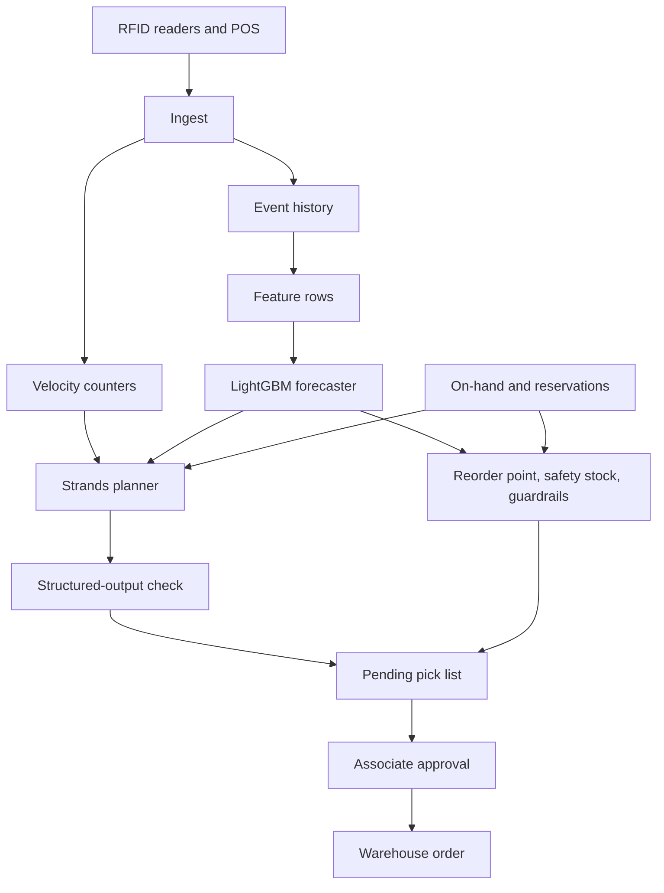
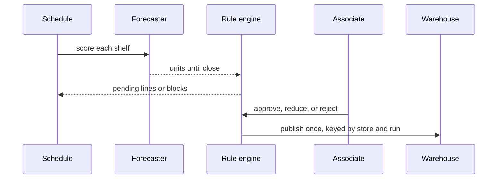

# Store-floor replenishment

A reference system that reads RFID counts and POS sales, estimates how many units a shelf will sell before close, and drafts a pick list for the back room.

Two paths make that decision:

- A LightGBM forecaster plus reorder rules. This is the path a scheduled job runs.
- A [Strands](https://strandsagents.com/) planner on Amazon Bedrock that calls the same forecast and inventory tools, then explains the list. Quantities still come from the rules. A check rejects a plan that changes them.

The sample data is synthetic. Nothing here was measured in a store. Holdout error printed by training is the error on that synthetic series, not a claim about a live shop.

Diagrams for the two paths live in [`docs/`](docs/).

## Architecture



Offline, ingest, counters, history, and pick lists are one SQLite file. On AWS the same records sit in one DynamoDB table, the stream is Kinesis, and the durable copy lands in S3 through Firehose. IoT Core can publish RFID payloads onto that stream.



The agent loop, when you ask for it, is the same decision with an extra narration step:

1. `read_shelf_velocity` reads the counters, not the raw log.
2. `check_inventory` reads on-shelf stock, backroom stock, capacity, and reservations.
3. `predict_burn_rate` scores the forecaster.
4. `draft_pick_list` runs the rule engine.
5. The model returns a `PickListPlan`. The process recomputes the plan and rejects the run if a quantity, priority, or block rule differs.

Offline, the "model" in that loop is a stub. It always uses that tool order and copies the draft. It does not call Bedrock. Set `REPLENISHMENT_LLM=bedrock` with AWS credentials when you want the real model. A Bedrock reply that edits a quantity is rejected and nothing is saved.

## Rules

For each shelf position:

```
safety stock = z * training residual * sqrt(hours left / hours open)
reorder point = forecast units until close + safety stock
need = ceil(reorder point - on shelf) when that gap is positive
quantity = min(need, open shelf space, backroom - reserved)
```

`z` defaults to 1.65. That is a policy constant, not a measured service level. The training residual has a floor of 0.25 so safety stock does not collapse to zero on a tiny sample.

Guardrails run in code after the quantity is chosen:

- On-shelf plus the order cannot exceed shelf capacity.
- The order cannot pull units reserved for another store.
- Missing, negative, or stale inventory or a missing forecast fails closed. Nothing is picked for that shelf.

A blocked line can be replaced by another SKU in the same category, nearest pack size first, up to three tries. The substitute quantity is the original gap, capped by the destination shelf. If none fit, the shelf is escalated and left off the pick list. Pack size ranks substitutes. It is not an order multiple.

A scheduled run saves a **pending** list. An associate approves it, rejects it, or lowers a quantity. A lower quantity is checked again. The warehouse write uses the store id and run id as an idempotency key, so a second approval does not create a second order.

## Forecast

Features for a row at time T use only events before T:

- sales in the previous one, two, and three hours
- the same hour yesterday
- mean pace over six hours and over seven days
- hour, weekday, hours until close
- promo flag, temperature, precipitation, foot traffic
- latest RFID count before T, shelf capacity, category, pack size

The label is units sold from T until close. The last calendar day in the file is the holdout. Training does not see it.

Sales in the generator are Poisson draws. The generator does not delete a sale when the shelf is empty, so the series is a demand signal rather than lost-sales data. After the history is written, on-hand counts are replaced with a fixed 16:00 snapshot so the walkthrough has a known stockout and a known reservation. Those counts are inputs.

| SKU | Shelf | On shelf | Backroom | Reserved |
| --- | --- | ---: | ---: | ---: |
| milk-1l | A1 | 1 | 18 | 0 |
| milk-2l | A1 | 10 | 8 | 0 |
| bread-loaf | A2 | 16 | 10 | 0 |
| bread-rolls | A2 | 20 | 10 | 0 |
| water-500 | B1 | 20 | 24 | 0 |
| water-1500 | B1 | 1 | 6 | 6, for the other store |
| chips-small | C1 | 36 | 0 | 0 |
| chips-large | C1 | 0 | 4 | 4, for the other store |

What gets ordered depends on the forecast. With a flat forecast of 8 units and a residual of 1, the rules order milk, substitute water-500 for the reserved 1.5L, and escalate the reserved chips because the other chips shelf has no room. The trained model will not match that flat forecast. Read the pick list the CLI prints.

## Agent or rules

This is a design judgement, not a benchmark.

| | Rules and the forecaster | Planner on top |
| --- | --- | --- |
| Decision | Forecast plus the formula above. Same inputs, same list. | The model chooses tool order and writes the explanation. The formula still sets every quantity. |
| New signal | A feature, a retrain, and a check against the holdout. | A new tool and a prompt change, then the same quantity check. |
| Cost | One local score, or one endpoint call, per store run. | Several model calls per store run. |
| Failure | A bad feature shows up as holdout error or a drift alarm. | A bad explanation is harmless. A changed quantity fails the run and writes nothing. |
| When it fits | The hourly job. The list has to be repeatable. | A person wants a written reason, or the signals change often enough that new tools are cheaper than new features. |

The hourly path does not need the planner. The planner is there when you want the explanation and you are willing to throw the run away if the text and the numbers disagree.

## Run it locally

Python 3.11 or newer.

```bash
python -m pip install -e ".[dev]"
python -m replenishment.cli bootstrap
python -m replenishment.cli score --store store-100
python -m replenishment.cli run --store store-100 --mode ml
python -m replenishment.cli run --store store-100 --mode agent --run-id evening-agent
python -m replenishment.cli approve --store store-100 --run-id evening-agent --action approve
```

`bootstrap` writes `data/replenishment.db`, `data/model/model.txt`, `data/model/metrics.json`, and `data/features/training.csv`. Metrics include the synthetic holdout WAPE and the WAPE of a naive mean. Compare those two numbers if you want to see whether this fit beat a constant on the fake series. Do not read them as store performance.

A run id is optional. If you omit it, the id is the store plus the decision hour, and a second run returns the list already saved.

The API:

```bash
python -m replenishment.cli serve --bootstrap
curl -s localhost:8000/health
curl -s -X POST localhost:8000/v1/stores/store-100/runs \
  -H 'content-type: application/json' \
  -d '{"mode":"ml","run_id":"api-demo"}'
curl -s -X POST localhost:8000/v1/stores/store-100/pick-lists/api-demo/approval \
  -H 'content-type: application/json' \
  -d '{"action":"approve"}'
```

Other routes: `GET /v1/model`, `GET /v1/stores/{store}/forecasts`, `GET /v1/stores/{store}/pick-lists`, `POST /v1/events`.

Docker builds the same API and trains on first start if the data volume is empty. The first start is slow because it fits the model.

```bash
docker compose up --build
```

Tests do not need AWS, Docker, or a model download:

```bash
pytest
```

## AWS

`infra/terraform` is the reference stack. It is not applied by CI.

Always created: KMS key, three S3 buckets (raw, features, models), a DynamoDB table, a Kinesis stream, Firehose into the raw bucket, an IoT topic rule on `stores/+/rfid`, a dead-letter queue, an alarm on that queue, a SageMaker model package group, a Bedrock guardrail for prompt attacks, and IAM roles scoped to those resources.

Created only with `-var enable_compute=true` after `scripts/package_lambda.sh`: the Lambda functions, the Step Functions state machine, an hourly schedule, and an HTTP API. The state machine scores, decides, re-checks guardrails, and saves a pending list. It does not publish to a warehouse. Approval stays on the API, including when that API is the local process.

```bash
bash scripts/package_lambda.sh
cd infra/terraform
terraform init
terraform plan
terraform plan -var enable_compute=true
```

A SageMaker endpoint stays off unless you also set `enable_sagemaker_endpoint`, `sagemaker_image_uri`, and `model_data_url`. The training and inference programs are `sagemaker/train.py` and `sagemaker/inference.py`. `sagemaker/Dockerfile` listens on port 8080 for `/ping` and `/invocations`. Training reads a CSV with the feature columns, `target`, and `split`. Point the Lambda at an endpoint with `REPLENISHMENT_ENDPOINT_NAME` and `REPLENISHMENT_RESIDUAL_STD` taken from `metrics.json`. Without those, scoring uses the local model file.

The Bedrock guardrail filters prompt attacks on model calls. It does not replace the shelf-capacity or reserved-stock checks.

## Layout

```
src/replenishment/    domain, synthetic data, features, model, rules, API, agent
sagemaker/            training script, inference functions, container
infra/terraform/      AWS stack
infra/step_functions/ state machine
docs/                 flow and design diagrams
tests/                pytest
```

## Assumptions

- Sample stores use UTC. Open is 08:00 and close is 21:00.
- Staleness is measured against the run's decision time, which the dataset stores, not the wall clock. A saved sample stays reviewable.
- Velocity counters are updated on ingest. The forecaster still trains on the raw events.
- The hash ring in `routing.py` records which regional agent would own a store. Offline there is one process; the region is only a label on the pick list.
- The DynamoDB client stores JSON documents under a store partition. A production counter would use a numeric `ADD` instead of read-modify-write on the velocity item.
